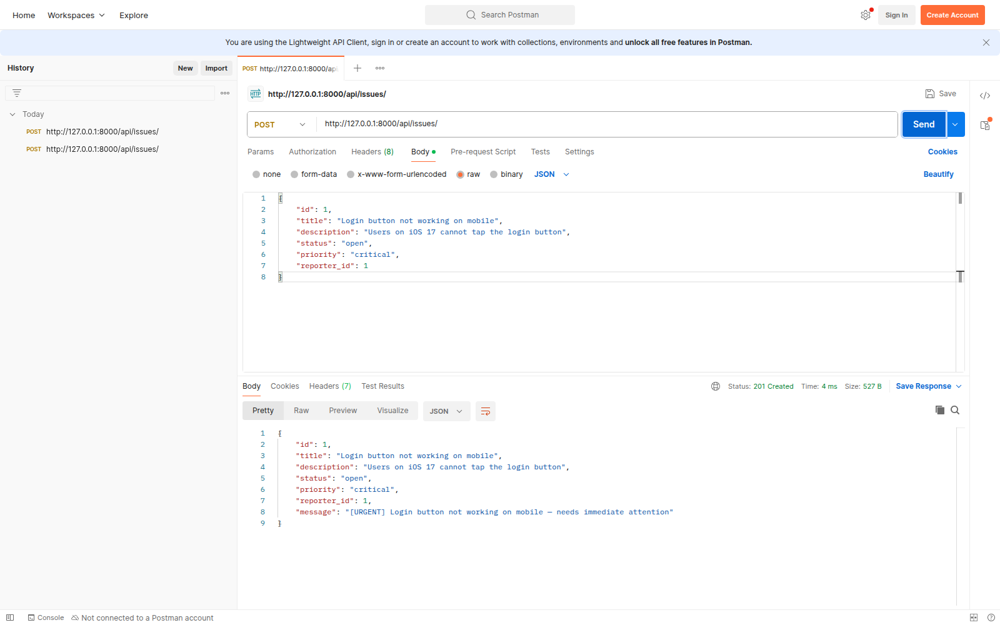
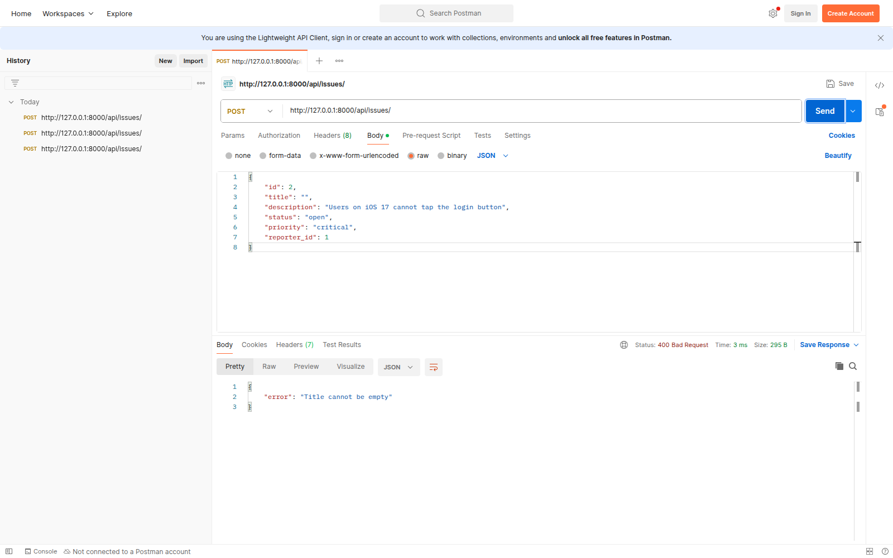

# Postman evidence

Captured on 2026-10-11 with Postman Desktop 12.31.7's Lightweight API Client
against the DevTrack Django server at `http://127.0.0.1:8000`.

## Success — 201 Created

The critical issue was filed by existing reporter 1. The response includes the
inherited entity fields and the overridden urgent description.

## Failure — 400 Bad Request

An issue with ID 2 and an empty title is rejected with
`{"error": "Title cannot be empty"}`.

Both captures show the POST URL, JSON request body, HTTP status, and server
response. The project's JSON data files remain empty for a clean first run.
